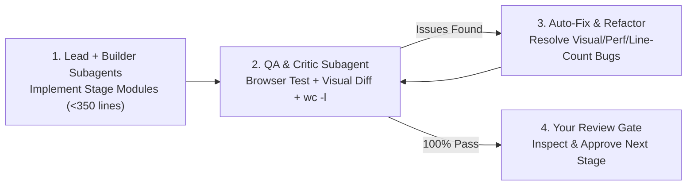

# Gardens by the Bay — Step-by-Step Engineering, QA & Self-Critic Plan

## 1. Core Engineering & Quality Rules (Enforced at Every Stage)
1. **Strict `< 400 Lines` Per File Cap:** Every `.js` and `.css` file must stay under **400 lines** (target `< 350 lines`). Large systems are split into focused domain modules (`src/core/`, `src/world/terrain/`, `src/world/landmarks/`, `src/entities/`, `src/ui/screens/`, `src/audio/`).
2. **60 FPS Performance & Zero Per-Frame Allocations:** Use `THREE.InstancedMesh` for foliage/Supertrees, merge static geometry where applicable, pre-allocate reusable math vectors (`THREE.Vector3`, `THREE.Matrix4`) outside `requestAnimationFrame`, and dispose unused GPU buffers.
3. **Mandatory Subagent QA & Adversarial Self-Critic Gate in Every Stage:**
   * Before the Lead Agent is allowed to finish any stage, it **must invoke an independent QA & Adversarial Critic Subagent** to audit:
     * **Visual Fidelity:** Compare live browser screenshots against [`GB-Map-15-02-2026.jpg`](./GB-Map-15-02-2026.jpg), [`OpenAI Playground 2026-10-24 at 09.07.26.png`](./OpenAI%20Playground%202026-10-24%20at%2009.07.26.png), and [`assets/screens/`](./assets/screens).
     * **Runtime Health:** Verify **0 console errors**, **0 WebGL warnings**, and **60 FPS** frame timing.
     * **Code Hygiene:** Run `wc -l` across all source files to verify **0 files exceed 400 lines**.
   * The Lead Agent **must fix all defects reported by the QA Subagent** before presenting the stage to you for review.

---

## 2. Step-by-Step Workflow with Built-In Subagent QA Loop

---

## 3. Master Copy-Paste Prompt Playbook (With Subagent QA & `< 400 Lines` Rules)

> [!TIP]
> **Power Slash Commands You Can Use:**
> * **`/goal`**: Type `/goal` before pasting a stage prompt when you want the agent to be extra thorough and **not stop** until the QA subagent verifies 100% of the stage criteria.
> * **`/boost`**: Type `/boost` when you want deep multi-perspective planning and rigorous verification on complex 3D stages.

| Stage | Upgraded Prompt to Copy & Paste (Includes Build + Refactor + Subagent QA Critic) | QA Subagent Verification Checklist |
| :--- | :--- | :--- |
| **Stage 1: 3D Peninsula, Water & Pathways + QA** | `/goal Build Stage 1 only: Set up the Three.js 60 FPS scene and build the Bay South 3D peninsula base, turquoise water, Dragonfly Lake channel, bridges, and cream pathway network matching GB-Map-15-02-2026.jpg and screen_01_title_peninsula_overview.png. STRICT RULES: (1) Split files under src/core/ and src/world/terrain/ so NO file exceeds 350 lines. (2) Zero object allocations inside requestAnimationFrame. (3) MANDATORY QA GATE: Before finishing, spawn a QA & Visual Critic subagent to launch the app in a live browser, verify 0 console/WebGL errors, check 60 FPS, compare the live 3D island silhouette/pathways against GB-Map-15-02-2026.jpg and screen_01, and run wc -l to confirm all files are < 400 lines. Fix every issue the QA subagent finds before stopping for my review.` | • Live browser render matches `GB-Map-15-02-2026.jpg` coastline & Dragonfly Lake. • 0 console/WebGL errors. • 60 FPS orbit/zoom. • All files `< 400 lines` (`wc -l`). |
| **Stage 2: 3D Landmarks & Foliage + QA** | `/goal Build Stage 2 only: Add all iconic 3D landmarks and foliage across Zones 1–5 matching screens 03–07 (18 Supertrees + OCBC Skyway, Flower Dome, Cloud Forest, Floral Clock, Red Moon Gate, Floating Baby Planet sculpture per reference_floating_baby_planet.png, SG50 Lattice, Children's Garden, and instanced trees). STRICT RULES: (1) Split into zone modules under src/world/landmarks/ so NO file exceeds 350 lines. (2) Use THREE.InstancedMesh for foliage and shared materials. (3) MANDATORY QA GATE: Spawn a QA & Visual Critic subagent to capture live close-up screenshots of each zone, critique them against screens 03–07 and reference_floating_baby_planet.png, verify 60 FPS and 0 console errors, and run wc -l (< 400 lines per file). Fix all critic findings before stopping for my review.` | • Close-up visual comparison of Supertrees, Domes & *Planet* Baby sculpture vs. `screens 03–07`. • Draw calls & 60 FPS verified. • All files `< 400 lines`. |
| **Stage 3: Explorer Avatar & Controls + QA** | `/goal Build Stage 3 only: Add the 3rd-person Miniature Explorer Avatar (safari helmet, blue backpack) with walk/sprint animations, pathway/bridge collision, and 3rd-person chase camera (WASD/Arrows + Space/Shift sprint). STRICT RULES: (1) Split into src/entities/ExplorerMesh.js, src/entities/PlayerController.js, and src/world/PathCollider.js so NO file exceeds 350 lines. (2) Pre-allocate all math vectors outside the frame loop. (3) MANDATORY QA GATE: Spawn a QA subagent to test walking and sprinting across all zones and bridges in the live browser, verify camera smoothness, check 0 console errors, and run wc -l (< 400 lines per file). Fix any collision or camera issues found before stopping for my review.` | • Automated browser walk/sprint test across paths & Dragonfly Bridge. • No stuck collisions or water clipping. • All files `< 400 lines`. |
| **Stage 4: 42 Treasures, Pickup UI & Full Map (`M`) + QA** | `/goal Build Stage 4 only: Add the 42 collectibles across all zones, golden Proximity Compass Ring at feet, discovery/stamp popup cards, bottom-left Minimap, [M] Full-Map Tracker (screen_11), and playable Relaxed Mode (Stopwatch). STRICT RULES: (1) Split into src/data/treasuresData.js, src/entities/TreasureManager.js, src/ui/MinimapHUD.js, and src/ui/FullMapOverlay.js so NO file exceeds 350 lines. (2) Batch treasure updates with shared materials. (3) MANDATORY QA GATE: Spawn a QA subagent to test collecting treasures in the live browser, verify counter updates (X/42), test pressing [M] against screen_11, verify 60 FPS & 0 errors, and check wc -l (< 400 lines per file). Fix all QA issues before stopping for my review.` | • Treasure pickup increments `X / 42` and shows popup. • Pressing `M` matches `screen_11` layout. • All files `< 400 lines`. |
| **Stage 5: 3 AI Bots & 4-Player Timed Race + QA** | `/goal Build Stage 5 only: Add the waypoint NavGraph and the 3 autonomous AI Bot explorers (Bot Kai Speedster, Bot Mei Radar, Bot Raj Pathfinder) with their visual auras, plus the 4-Player Timed Race mode (03:00 / 05:00) and Live Standings HUD (screen_09). STRICT RULES: (1) Split into src/world/NavGraph.js, src/entities/AIBotController.js, src/entities/BotAuraEffects.js, and src/ui/RaceStandingsHUD.js so NO file exceeds 350 lines. (2) Throttle AI pathfinding so 60 FPS never drops. (3) MANDATORY QA GATE: Spawn a QA subagent to observe a live 4-player Timed Race in the browser, verify all 3 bots actively move and collect items without getting stuck, compare HUD against screen_09, and run wc -l (< 400 lines per file). Fix all QA findings before stopping for my review.` | • All 3 AI bots actively navigate paths and score points. • Live 4-player scoreboard updates accurately. • All files `< 400 lines`. |
| **Stage 6: Menus, Night Show, Encyclopedia & Audio + QA** | `/goal Build Stage 6 only: Add Screen 01 (Title), Screen 02 (Expedition Setup), Screen 08 (Garden Rhapsody Night Show), Screen 10 (Encyclopedia & Leaderboard), and Web Audio SFX. STRICT RULES: (1) Split UI screens under src/ui/screens/ and CSS into modular stylesheets so NO JS or CSS file exceeds 350 lines. (2) MANDATORY QA GATE: Spawn a QA & Adversarial Critic subagent to test the full end-to-end game flow (Screen 01 -> Screen 02 -> Day & Night Gameplay -> Screen 11 Map -> Screen 10 Leaderboard), compare against screens 01, 02, 08, 10, verify 0 console errors & 60 FPS, and audit wc -l across all files (< 400 lines). Fix every issue before stopping for my review.` | • Full end-to-end UI flow & Night Show emissive glow verified. • 0 console errors. • Every `.js` & `.css` file `< 400 lines`. |
| **Stage 7: Final QA Sign-Off & Netlify `.zip` Package** | `/goal Build Stage 7: Run a final full-project QA & performance audit with a QA subagent: (1) Confirm wc -l < 400 lines on every JS/CSS file. (2) Confirm 60 FPS and 0 console/network errors across Relaxed Mode and 4P Timed Race. (3) Package only the clean runtime production files (excluding raw reference mockups) into gbb-treasure-hunt-netlify.zip (< 15 MB) and verify the extracted zip runs cleanly.` | • Production zip verified `< 15 MB`. • Extracted build tested in browser with 0 broken paths or errors. |
